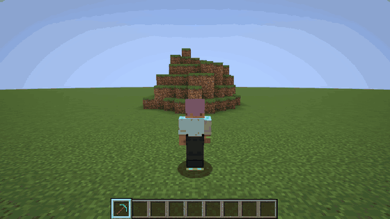
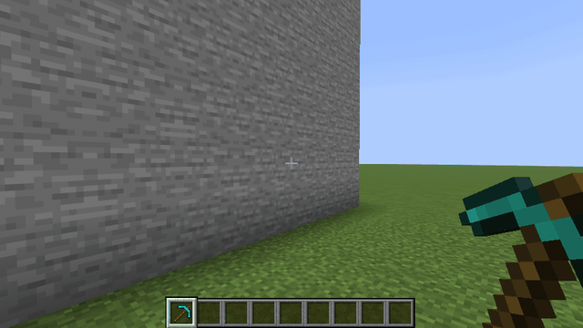
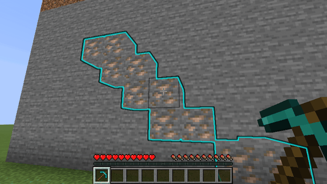
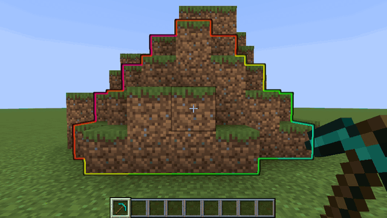
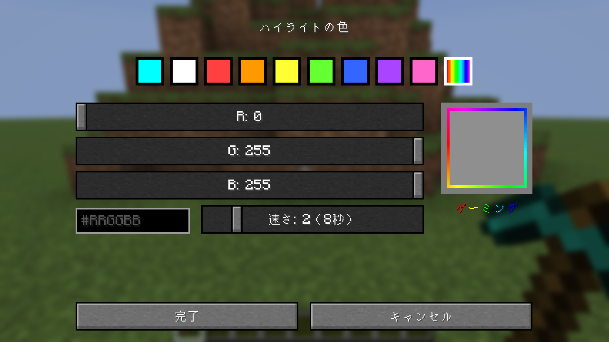
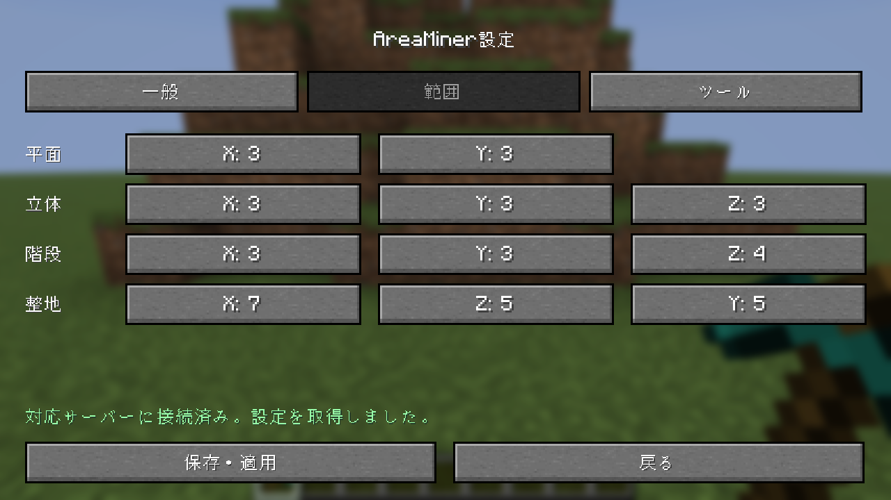

# AreaMiner

Minecraft Java版向けの段階式範囲破壊。石・土などの対象ブロックを、平面・立体・階段の形でまとめて掘ります。整地モードでは足元から上を平らに削れます。

| 配布物 | 対象 | 役割 |
|---|---|---|
| `AreaMiner-paper-*.jar` | Paper サーバー | 範囲破壊本体（プラグイン） |
| `AreaMiner-fabric-*.jar` | Fabric クライアント／Fabric サーバー | 設定画面・専用キー＋範囲破壊本体（MOD） |

対応する Minecraft・Fabric Loader・Fabric API のバージョンは各リリースに記載しています。

## どこに何を入れるか

| 遊び方 | サーバー側 | クライアント側 |
|---|---|---|
| Paper サーバー | Paper プラグイン | Fabric MOD（任意。無くてもコマンドと Shift＋F で使えます） |
| Fabric サーバー | Fabric MOD | Fabric MOD（任意。バニラクライアントでも参加できます） |
| シングルプレイ | — | Fabric MOD のみ |

Fabric MOD は 1 つの jar でクライアントとサーバーの両方に対応します。  
クライアントに入れるとシングルプレイの内蔵サーバーでも範囲破壊が動きます。Fabric MOD には [Fabric API](https://modrinth.com/mod/fabric-api) が必要です。  
[Mod Menu](https://modrinth.com/mod/modmenu) を入れている場合は、そこからも設定画面を開けます。

表示は日本語と英語に対応しています（ゲームの言語設定に従い、その他の言語では英語）。

使い方の詳細: [docs/paper.txt](docs/paper.txt)（コマンド・設定・挙動）／ [docs/fabric.txt](docs/fabric.txt)（MOD の導入・設定画面・キー）

## 画面で見る

### モードの切り替え

Fabric MOD の切り替えキー（MOD がないときはスニーク＋F）で、OFF → 平面 → 立体 → 階段 → 整地 → OFF の順に切り替わります。掘る範囲は、掘る前にハイライトで表示されます。

### 鉱脈

モードが ON のときに鉱石を掘ると、範囲の代わりに、つながっている同じ鉱石をすべて掘ります（斜めに接していてもつながりとして扱います）。ドロップは足元に集まります（初期設定）。

### ハイライトの色

ハイライトの色は自分で選べます。9色の見本、R・G・B のスライダー、カラーコード（`#RRGGBB`）のどれでも選べます。虹色が範囲を流れる「ゲーミング」もあります。ゲーミングの速さは 1〜8 で、初期値の 2 だと 8 秒で1周します。
コマンドでも変えられます: `/areaminer color red`・`/areaminer color #FF8800`・`/areaminer color gaming 4`

### 設定画面（Fabric MOD）

モードごとの範囲、ハイライト（色も）、ドロップ位置、耐久、対象のツールを設定できます。ドロップ位置はサーバー側で全員分を決めることもできます（そのときは設定画面で変更できません）。

